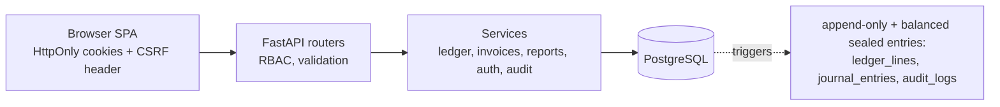

# LedgerCore

A double-entry accounting API and web UI built around one idea: **the books must be provably correct**.
Balances are derived, never stored. Ledger rows cannot be edited. The audit trail is hash-chained.

**Stack:** FastAPI · SQLAlchemy 2 · PostgreSQL · Alembic · Pydantic v2 · Argon2 · vanilla JS (no build step) · Docker Compose · GitHub Actions

## What it does

- **Double-entry journal.** Every entry must balance to the cent. Corrections are reversal entries, never edits. An entry can be reversed at most once (enforced by a unique constraint, not just code).
- **Invoicing with multi-currency.** Tax, partial payments, voiding, and **realized FX gain/loss** when a payment is received at a different rate than the invoice was issued at. Invoice and base currencies are checked against the SIX List One snapshot, accepting only current currency entries with a defined minor-unit exponent. Funds, precious metals, bond-market units, special accounting units, test codes, and historical/no-currency codes are rejected.
- **Reports.** Trial balance (with CSV export), income statement, balance sheet. Dashboard with monthly revenue vs expenses.
- **Accounting periods.** The CFO can close a period; postings into a closed period are rejected.
- **Roles.** `VIEWER` (read), `ACCOUNTANT` (post, invoice, record payments), `CFO` (reverse, void, close periods, manage users, read audit trail).
- **Multi-tenant workspaces.** Company signup creates an isolated workspace, provisions the first user as CFO, and seeds a company-local chart of accounts. CFOs can add users to their own workspace.
- **Tamper-evident audit trail.** Every business action is logged and chained with SHA-256; `/audit-logs/verify` recomputes the chain.

## Architecture



Layering rule: routers handle HTTP only, services hold every business rule and raise `DomainError`
subclasses (no FastAPI imports), and the database enforces the invariants that must never break.

## Design decisions

| Decision | Why |
|---|---|
| **Balances are computed from `ledger_lines`**, no stored balance column | Removes an entire class of race conditions and drift bugs. |
| **`Decimal` end to end**, `Numeric(14,2)`, input rejects more than 2 decimal places | `10.005` is a validation error, never silently rounded into an unbalanced entry. |
| **Active ISO 4217 currency registry** for invoices and `BASE_CURRENCY` | The registry is generated from the published SIX List One snapshot and includes only non-fund currency entries with a defined minor-unit exponent. |
| **Ledger immutability and entry seals**: ORM listeners, database triggers, and no update/delete endpoints; a sealed entry rejects later line inserts. | Posted entries cannot be extended after approval, including through raw SQL. |
| **Deferred PostgreSQL balance constraint**: each journal entry must be sealed and contain at least two lines whose debit and credit totals match at commit. | An application bug or raw SQL cannot commit an incomplete or unbalanced entry. |
| **Idempotent financial writes**: actor + operation + `Idempotency-Key` + canonical request hash, with the response stored in the same transaction. | A retry after a lost response returns the original result instead of posting twice. |
| **Reversal uniqueness is a DB constraint** (`UNIQUE(reverses_entry_id)`) | Two concurrent reversals cannot both succeed. |
| **Gapless per-workspace numbering** via `UPDATE ... RETURNING` on an organization-scoped sequence row | Invoice and journal numbers have no gaps or duplicates, and roll back with the transaction. |
| **Optimistic locking** (`version_id`) plus `SELECT ... FOR UPDATE` on invoices | Concurrent payments on one invoice cannot corrupt it; the loser gets HTTP 409. |
| **Final payment clears exactly the remaining base receivable** | Per-payment rounding can never leave a stray cent in A/R. |
| **OVERDUE is derived** from `due_date`, never stored | No GET endpoint writes to the database; no cron job needed for correctness. |
| **Per-workspace hash-chained audit log** under an organization-scoped sequence lock, checked against a monotonic sequence high-water mark | Edits, gaps, and deletion of the chain tail are detectable; the high-water mark itself cannot be lowered or deleted through ordinary SQL. |
| **Accounting-period row lock** created even for previously untouched months | Closing a period serializes with the posting check for that same period. |

## Security model

- **Argon2id** password hashing; unknown-email logins burn a dummy verification so timing does not reveal accounts.
- **Auth in HttpOnly, SameSite=Strict cookies** (no token in JavaScript or `localStorage`). Access token: 15 minutes.
- **Single-use rotating refresh tokens**, stored only as SHA-256 hashes. An atomic conditional update allows one consumer; replay revokes the whole token family, including a concurrent successor.
- **CSRF protection** with a double-submit token on authenticated write routes and both session endpoints (`/auth/refresh` and `/auth/logout`).
- **Database-backed login throttling** per email and per IP, serialized with transaction-scoped PostgreSQL advisory locks so parallel requests cannot exceed either limit. Expired login-attempt history is pruned in bounded batches after 30 days.
- **Workspace registration.** The first registrant becomes that workspace's CFO; the CFO can create additional users. Registration enforces same-origin submissions in production and requires a 12-character password. `SECRET_KEY` has no default and the app refuses to start without a strong one.
- **Strict CSP** (`script-src 'self'`), `nosniff`, frame denial, `no-store` on API responses, HSTS in production.
- The UI builds DOM with `textContent` only, so API data cannot inject markup. CSV export neutralises spreadsheet formula injection.


## Multi-tenant workspaces

Each user belongs to one organization. The first user created through **Create a company account**
is that organization's CFO; the CFO can then create additional users from the Users screen.
Email addresses remain globally unique.

Financial and operational records carry an `organization_id`. PostgreSQL row-level security
enforces that scope for accounts, periods, sequences, journals, seals, ledger lines, invoices,
payments, audit logs, and idempotency records. Request sessions set a transaction-local tenant
context, while ORM criteria provide an additional application-level guard. Database triggers
reject cross-organization references between ledger entries, accounts, invoices, and payments.

Migration `0004` creates the default organization and backfills all existing users and financial
records into it, preserving existing sign-in and ledger history. It also changes document,
period, audit, and idempotency keys to be organization-local. Apply migrations with the
`ledger_migrator` role before deploying the application code:

```bash
alembic upgrade head
```

The initial registrant receives the CFO role automatically. Email verification and organization
invitation links are not part of this release; CFO-created users are provisioned directly.

## Running it

**Docker (PostgreSQL):**

```bash
cp .env.example .env        # fill SECRET_KEY and all three database passwords
docker compose up --build
# open http://localhost:8000 and sign in as INITIAL_ADMIN_EMAIL
```

PostgreSQL credentials are separated by role: `ledger` is the bootstrap administrator used only
for database bootstrap, `ledger_migrator` owns the application schema and runs Alembic, and
`ledger_app` is the runtime API login. The runtime role receives DML privileges only; it cannot
run schema DDL, drop triggers, or `TRUNCATE` ledger tables.

For an existing installation, keep the current `pgdata` volume and the current `POSTGRES_PASSWORD`
for the `ledger` bootstrap user. Add strong values for `LEDGER_MIGRATOR_PASSWORD` and
`LEDGER_APP_PASSWORD` to `.env`, then run `docker compose up --build`. The `role-bootstrap`
service runs on each Compose start, creates missing roles, and transfers existing LedgerCore
schema objects to `ledger_migrator` before migrations run. Do **not** use `docker compose down -v`;
that would delete the database volume.

If `INITIAL_ADMIN_PASSWORD` is empty, a random password is generated and printed once in the API logs
(`docker compose logs api`). Set `SEED_DEMO_DATA=true` to load three months of sample activity.

**Local development (SQLite):**

```bash
python -m venv .venv && source .venv/bin/activate
make install
cp .env.example .env        # set SECRET_KEY; use DATABASE_URL=sqlite:///./data/ledgercore.db
make dev                    # alembic upgrade head, then uvicorn --reload
```

For local HTTP development, set `ENVIRONMENT=development` and `COOKIE_SECURE=false` in `.env`.
Production refuses `COOKIE_SECURE=false`; use HTTPS and keep it `true`.

Interactive API docs: `http://localhost:8000/docs`


## Deploying to Vercel

LedgerCore uses Vercel's native FastAPI framework detection with `app/main.py` as the ASGI entry point; no catch-all rewrite or wrapper function is needed. The SPA assets under `app/static/` are explicitly included in the function bundle and served by FastAPI. Vercel's serverless runtime uses SQLAlchemy `NullPool` so instances do not retain idle PostgreSQL connections between invocations.

**Required setup before the first deployment:**

1. Create a managed PostgreSQL database (for example, Neon). Use a dedicated `ledger_app` login for the Vercel runtime with DML-only privileges; do not use the bootstrap superuser or migration owner as the runtime credential.
2. In Vercel Project Settings, set `SECRET_KEY` (at least 32 random characters), `DATABASE_URL` (the runtime `ledger_app` connection string), `ENVIRONMENT=production`, `COOKIE_SECURE=true`, and `SEED_ON_STARTUP=false`. Set `BASE_CURRENCY` if it differs from USD. Optionally set both `DEMO_VIEWER_EMAIL` and `DEMO_VIEWER_PASSWORD` only if a read-only public demo is intended.
3. Before the first deployment, run Alembic from a trusted workstation or migration runner using the separate `ledger_migrator` connection string as `DATABASE_URL`: `python -m alembic upgrade head`. Do not run migrations from a Vercel function or from every application startup.
4. Bootstrap the initial CFO exactly once from a trusted environment after migrations, with `DATABASE_URL` set to the migration/administrative connection as required by the seed operations, and `INITIAL_ADMIN_EMAIL` plus a strong `INITIAL_ADMIN_PASSWORD` set: `python scripts/bootstrap.py`. Keep the bootstrap command and credentials out of the public deployment logs and remove temporary credentials from the runner afterward.
5. Deploy a Preview first. Verify `/health/ready`, login, refresh/logout, role permissions, a balanced journal entry, and the audit verification endpoint before promoting to Production.

The application is not ready for production merely because Vercel builds it: managed PostgreSQL, role provisioning, migrations, one-time administrator bootstrap, and post-deploy financial/authentication checks are operator prerequisites. Do not set `SEED_ON_STARTUP=true` on a multi-instance serverless deployment; concurrent cold starts must not race to seed production data.

## Screenshots and demo access

The browser suite captures the seeded dashboard and a posted journal entry in `docs/screenshots/`. GitHub Actions uploads these files as the `ledgercore-browser-screenshots` artifact after the Playwright job.

**Production deployment:** [https://ledgercore-silk.vercel.app](https://ledgercore-silk.vercel.app)

The production app uses a dedicated managed PostgreSQL database. Sign-in is required; the initial CFO account is
provisioned separately, and no public demo credentials are enabled.

To expose an additional public read-only demo, set `DEMO_VIEWER_EMAIL` and `DEMO_VIEWER_PASSWORD` in the
deployment environment. Startup provisions that account with `VIEWER` role only; both settings are required
together, and there are no shipped demo credentials.

## Testing

```bash
make test        # pytest with coverage gate (85%)
make lint        # ruff
make typecheck   # mypy
```

Set `TEST_DATABASE_URL=postgresql+psycopg://...` to run the suite on PostgreSQL (CI does); otherwise it uses SQLite. The deferred balance/seal constraints and row-lock race tests require PostgreSQL.

The suite covers authentication (cookie flags, throttling, atomic refresh rotation and replay detection, CSRF on logout),
role permissions, idempotent financial requests, ledger rules (balance, precision, reversals, sealed entries, closed periods),
invoicing (tax, FX gain and loss, installments, voiding, optimistic locking), reports, audit-chain tail deletion, raw-SQL
trigger enforcement, and security headers. It also includes **property-based tests (Hypothesis)** and PostgreSQL-only
concurrency tests for refresh-token replay, period-close/posting races, line-insert/seal races,
and audit sequence high-water mark protection.

Browser tests use **Playwright** against the actual SPA: an administrator signs in and posts a balanced journal entry,
a read-only demo user is checked at a mobile viewport, and parallel requests from two tabs are
verified to share one refresh-token rotation.

CI (`.github/workflows/ci.yml`) runs ruff, mypy, `pip-audit`, pytest on PostgreSQL, Playwright browser tests, an Alembic
**migration-parity check** (`alembic upgrade head` then `alembic check` must show no drift), and a Docker Compose smoke test.

## API overview (`/api/v1`)

All financial write endpoints (journal create/reverse, invoice create/payment/void) require an `Idempotency-Key` request header (16–255 characters). Reuse the same key only for a retry of the same operation and payload; reusing it with a different payload returns HTTP 409. The browser persists the pending key for the current session and reuses it after network failures.

| Area | Endpoints |
|---|---|
| Auth | `POST /auth/login`, `/auth/refresh`, `/auth/logout`, `GET /auth/me` |
| Users (CFO) | `GET/POST /users`, `PATCH /users/{id}` |
| Accounts | `GET /accounts`, `POST /accounts` (CFO) |
| Journal | `GET/POST /journal-entries`, `GET /journal-entries/{id}`, `POST /journal-entries/{id}/reverse` (CFO) |
| Invoices | `GET/POST /invoices`, `GET /invoices/{id}`, `POST /invoices/{id}/payments`, `POST /invoices/{id}/void` (CFO) |
| Reports | `/reports/trial-balance` (+ `/export`), `/reports/income-statement`, `/reports/balance-sheet`, `/dashboard/summary` |
| Admin (CFO) | `GET /periods`, `POST /periods/{YYYY-MM}/close` and `/reopen`, `GET /audit-logs`, `GET /audit-logs/verify` |
| Ops | `GET /health`, `GET /health/ready` |

## Project layout

```
app/
  core/       config, database, security, deps (RBAC + CSRF), errors, money, DB triggers
  services/   ledger, invoices, reports, auth, audit, periods, sequences (all business rules)
  api/        thin FastAPI routers
  static/     SPA (index.html, app.js, styles.css)
  models.py   SQLAlchemy models        schemas.py   Pydantic models
alembic/      migrations 0001 (base), 0002 (seals/idempotency), 0003 (restricted app role grants)
tests/        pytest + Hypothesis + PostgreSQL concurrency
e2e/          Playwright browser tests
```

## Known limitations (deliberate scope)

- The ledger is in a single base currency; foreign-currency invoices are converted at issue and payment rates.
  There is no period-end revaluation of open foreign-currency receivables.
- No MFA or password reset flow. Login throttling keys on the client IP as seen by the app (put it behind a trusted
  proxy that sets `--proxy-headers` correctly). Idempotency records are retained until an operational retention policy is configured.
- The audit chain proves tampering happened; it does not prevent someone with database superuser rights from
  dropping the triggers. Ship the chain head hash to an external store for stronger guarantees.
- The base currency constant in `app.js` mirrors the server's `BASE_CURRENCY`.

## License

MIT
